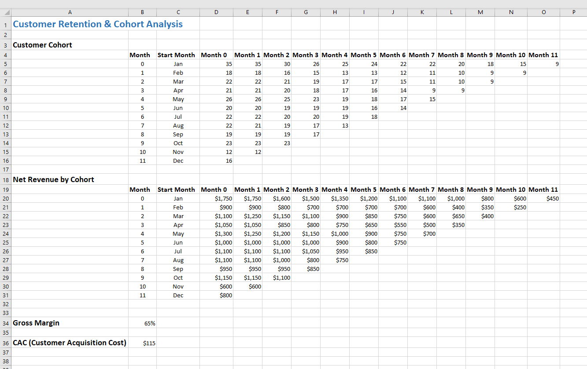
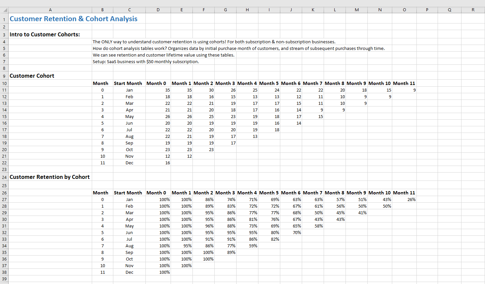
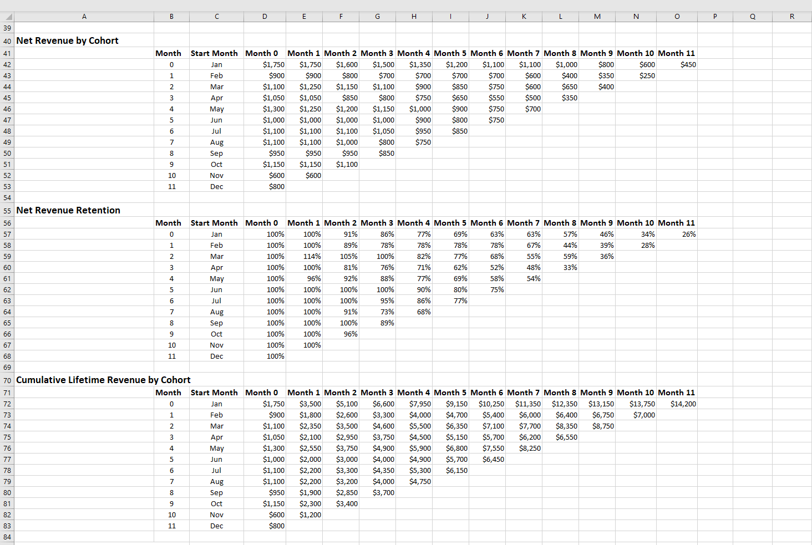
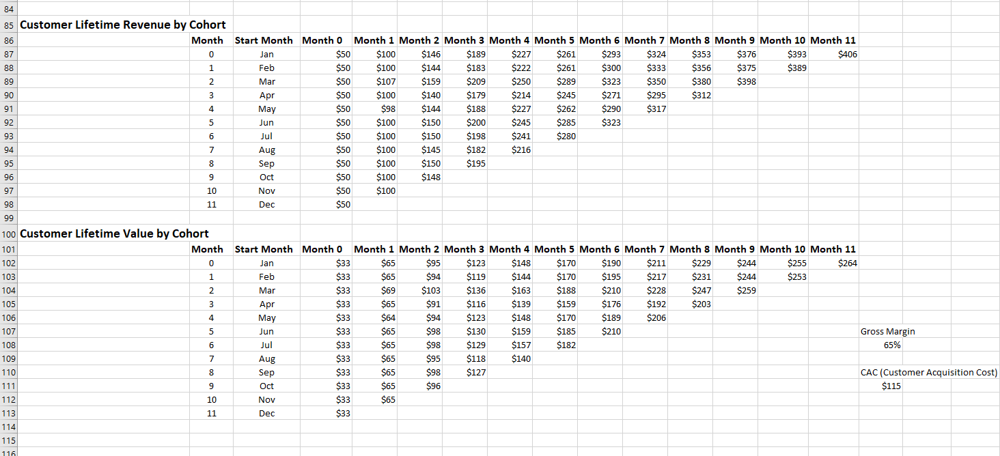

# Customer Cohort Analysis: Retention, Revenue & Customer Lifetime Value | Microsoft Excel

## Overview

An Excel-based customer cohort analysis model examining customer retention, net revenue retention (NRR), cumulative revenue, and customer lifetime value (CLV) using illustrative SaaS subscription data.

The project demonstrates how cohort-based analysis can help evaluate customer retention patterns, track revenue generated over time, and estimate customer lifetime value using gross margin assumptions.

## Dataset & Model Assumptions

| Parameter | Assumption |
|---|---:|
| Monthly subscription price | $50 |
| Gross margin | 65% |
| Customer acquisition cost (CAC) | $115 |

These are illustrative assumptions used in the model, not verified business results. CAC is included as an input but is not used to calculate an LTV:CAC ratio or CAC payback period.

## Project Preview

## Analysis & Calculations

- **Customer Retention:** Measures the percentage of customers from an initial acquisition cohort who continue purchasing in subsequent periods.
- **Net Revenue Retention (NRR):** Compares revenue generated by a cohort in subsequent periods against its initial-period revenue.
- **Cumulative Lifetime Revenue:** Calculates the running total of revenue generated by each customer cohort.
- **Average Lifetime Revenue per Customer:** Calculates cumulative cohort revenue per initially acquired customer.
- **Customer Lifetime Value (CLV):** Estimates gross profit per acquired customer using lifetime revenue and an assumed gross margin.

## Excel Techniques Applied

- Excel formulas and calculated metrics
- Relative and absolute cell references
- Formula copying across cohort analysis tables
- Running-total calculations
- Assumption-based financial modeling

## Workbook Structure

- `Data`: Illustrative customer counts and monthly revenue organized by cohort.
- `Customer Cohort Analysis`: Formula-driven calculations for retention, revenue retention, cumulative revenue, customer lifetime revenue, and customer lifetime value.

## Project Files
- `Customer-Cohort-Analysis.xlsx` — Excel workbook.
- `customer-cohort-analysis-preview1.png` — Analysis screenshot 1.
- `customer-cohort-analysis-preview2.png` — Analysis screenshot 2.
- `customer-cohort-analysis-preview3.png` — Analysis screenshot 3.
- `dataset-assumptions-preview.png` — Dataset & Assumptions screenshot.
